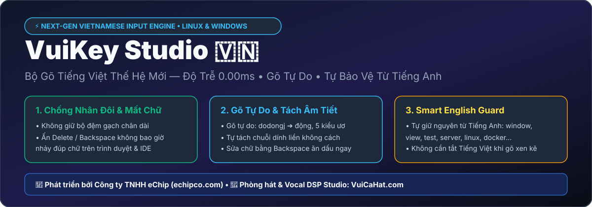

# VuiKey Studio 🇻🇳⚡⌨️

[](#-tài-liệu-tiếng-việt-vietnamese-documentation)
[-10b981?style=flat-square)](https://github.com/mrtrinhvn/VuiKey/releases/latest/download/vuikey_1.0.0_amd64.deb)
[-0ea5e9?style=flat-square)](https://github.com/mrtrinhvn/VuiKey/releases/latest/download/VuiKey-1.0.0-windows-amd64.zip)
[](AGENTS.md)
[_%7C_Windows_10/11_x64-f97316?style=flat-square)](#-bảng-tương-thích-hệ-điều-hành-linux--windows)
[](LICENSE)

<p align="center">
  <b><a href="#-tài-liệu-tiếng-việt-vietnamese-documentation">🇻🇳 Đọc bản Tiếng Việt</a></b> &nbsp;•&nbsp;
  <b><a href="#-english-documentation">🇺🇸 Read in English</a></b> &nbsp;•&nbsp;
  <b><a href="https://echipco.com/vuikey">🌐 Trang chủ VuiKey (echipco.com/vuikey)</a></b> &nbsp;•&nbsp;
  <b><a href="https://echipco.com">🏢 Công ty TNHH eChip (echipco.com)</a></b> &nbsp;•&nbsp;
  <b><a href="https://vuicahat.com">🎤 VuiCaHat.com</a></b>
</p>

<p align="center">
  
</p>

---

# 🇻🇳 Tài Liệu Tiếng Việt (Vietnamese Documentation)

**VuiKey** là bộ gõ Tiếng Việt thế hệ mới dành cho cả **Linux Desktop** (`Ubuntu`, `Pop!_OS`, `Linux Mint`, `Debian`, `Fedora`, `Arch`, `Manjaro`, `openSUSE` — hỗ trợ cả **X11** và **Wayland**) và **Windows 10 / 11 (64-bit Portable)**, được nghiên cứu và phát triển bởi đội ngũ kỹ thuật [**Công ty TNHH eChip (`echipco.com`)**](https://echipco.com) cùng nền tảng âm nhạc trực tuyến [**VuiCaHat (`vuicahat.com`)**](https://vuicahat.com).

> ⭐ **Nếu bạn từng gặp cảnh đang gõ văn bản mà bị nhảy đúp cả cụm chữ khi bấm `Delete`/`Backspace`, gõ xen kẽ tiếng Anh bị biến thành chữ lỗi (`window` ➔ `ưindoư`, `test` ➔ `tét`), hoặc bấm xóa lùi 1 ký tự để sửa mà không thể bỏ dấu tiếp được (phải xóa sạch cả từ gõ lại từ đầu) — thì VuiKey được sinh ra chính là dành cho bạn. Hãy tặng dự án 1 ngôi sao (Star) ở góc trên bên phải GitHub để ủng hộ nhóm phát triển nhé!**

---

## 🚀 Tải Về & Cài Đặt Nhanh (Linux & Windows)

### 🪟 Cho Windows 10 / Windows 11 (64-bit Portable — Chạy ngay, không cần cài đặt)
- **Tải trực tiếp:** [**`VuiKey-1.0.0-windows-amd64.zip`**](https://github.com/mrtrinhvn/VuiKey/releases/latest/download/VuiKey-1.0.0-windows-amd64.zip)
- Giải nén và nhấp đúp vào **`VuiKey.exe`** (chỉ `1.9 MB`, độc lập 100%, không cần cài `.NET` hay thư viện phụ trợ, tích hợp sẵn khay hệ thống **`[VN]` / `[EN]`**, phím tắt `Ctrl+Space` và tùy chọn *Khởi động cùng Windows*).

### 🐧 Cách 1 (Linux): Cài từ gói `.deb` dựng sẵn (Ubuntu, Pop!_OS, Linux Mint, Debian, Zorin, Kali)
```bash
wget -O /tmp/vuikey_1.0.0_amd64.deb https://github.com/mrtrinhvn/VuiKey/releases/latest/download/vuikey_1.0.0_amd64.deb
sudo apt install -y /tmp/vuikey_1.0.0_amd64.deb
vuikey gui
```

### 🐧 Cách 2 (Linux): Cài đặt tự động 1 dòng lệnh cho mọi bản Linux (`apt`, `dnf`, `pacman`, `zypper`)
```bash
curl -fsSL https://raw.githubusercontent.com/mrtrinhvn/VuiKey/main/scripts/install-linux.sh | bash
```

### 🤖 Cách 3: Giao cho AI Agent (Google Antigravity / Claude Code / Codex / Cursor)
> *"Hãy clone `https://github.com/mrtrinhvn/VuiKey`, đọc `AGENTS.md`, tự động cài đặt VuiKey và bật giao diện `VuiKey Studio` cho tôi."*

---

## 🔥 5 Ưu Việt Đột Phá Của VuiKey (Giải Quyết Triệt Để Những Phiền Toái Khi Gõ Tiếng Việt)

### 1. 🛡️ Gõ Tiếng Anh Xen Kẽ Tự Nhiên Mà Không Cần Tắt Bộ Gõ (`Phonotactic Smart English Guard`)
- **Vấn đề thường gặp ở các bộ gõ khác:** Khi đang bật chế độ Tiếng Việt (trên máy tính hoặc điện thoại) mà gõ xen kẽ các từ Tiếng Anh như `window`, `view`, `function`, `test`, `user`, `server`, `linux`, `docker`, `arrow`..., chữ lập tức bị biến dạng thành `ưindoư`, `vieư`, `tét`, `úer`, `sẻver`, `lĩnu`... hoặc bị tự động sửa từ sai nghĩa khiến bạn phải xóa đi gõ lại rất mất thời gian.
- **Cách VuiKey xử lý:** Phân tích cấu trúc âm vị học Tiếng Việt theo thời gian thực (luật `VCV: Nguyên âm + Phụ âm + Nguyên âm` vốn không tồn tại trong đơn âm tiết Tiếng Việt) kết hợp từ điển kỹ thuật để **tự động nhận diện và giữ nguyên 100% từ Tiếng Anh** ngay trong lúc đang bật Tiếng Việt mà không cần bấm `Ctrl + Space`.

### 2. 🔓 Bấm `Backspace` Sửa Chữ Nhận Dấu Ngay Lập Tức (Không Bao Giờ Phải Xóa Lại Từ Đầu)
- **Vấn đề thường gặp ở các bộ gõ khác:** Khi bạn vô tình gõ nhầm 1 phím trong từ (làm từ bị "đóng" hoặc mất trạng thái âm tiết), dù bạn bấm `Backspace` xóa ký tự gõ nhầm đi rồi gõ lại dấu sắc/huyền/nặng/móc vẫn không ăn, buộc phải xóa lùi về tận chữ cái đầu tiên mới gõ lại được.
- **Cách VuiKey xử lý:** Ngay ở nhát bấm `Backspace` đầu tiên, **VuiKey** lập tức mở khóa trạng thái âm tiết và khôi phục ngữ cảnh vần trước đó (ví dụ gõ nhầm `phuwcf` ➔ bấm `Backspace` 1 lần ➔ gõ tiếp `cs` ra ngay **`phức`** mượt mà).

### 3. 🎯 Gõ Tự Do Toàn Diện (`Free-Style Telex / VNI`) — Hỗ Trợ `dodongj` ➔ `động` & Cả 5 Thứ Tự Gõ `ươ`
- **Vấn đề thường gặp ở các bộ gõ khác:** Bắt người dùng phải gõ 2 chữ `dd` liền nhau ngay từ đầu từ, hoặc chỉ nhận đúng 1–2 thứ tự bỏ dấu cho nguyên âm đôi `ươ`, khiến khi gõ nhanh ở tốc độ cao dễ bị rớt dấu mũ/móc hoặc mất chữ (`mà thành khác nữa` bị đứt thành `mà thành khá ữa`).
- **Cách VuiKey xử lý:**
  - Cho phép gõ chữ **`d` thứ hai ở bất kỳ vị trí nào trong âm tiết**: `dodongj`, `doongdj`, `doongjd`, `dongodj`, `dongojd` đều ra chuẩn **`động`**; `duocwjd`, `duowcjd` đều ra **`được`**.
  - Hỗ trợ trọn vẹn cả **5 thói quen gõ nguyên âm đôi `ươ`**: `dduowcj`, `dduocwj`, `dduwowcj`, `dduwocwj`, `dduwocj` ➔ **`được`**; `phuwcs`, `phucws`, `phucsw`, `phwcs`, `phwucs` ➔ **`phức`**.

### 4. ✂️ Cửa Sổ Âm Tiết Trượt Thông Minh (`Sliding Syllable Window`) & Chống Nhân Đôi Chữ 100%
- **Vấn đề thường gặp ở các bộ gõ khác:** Khi bạn gõ các chuỗi dài không dấu cách (như tên file, đường dẫn URL, mật khẩu, hashtag hoặc chuỗi thẻ `nhacdidangnhactiengdidangtiengchoitai`) rồi ấn phím `Delete`, `Backspace` hoặc phím mũi tên, bộ đệm gạch chân bị giữ quá dài sẽ gây xung đột sự kiện làm **nhân đôi cả đoạn chữ** (`nhacdidang...hacdidang...`) trên thanh địa chỉ trình duyệt và các trình soạn thảo hiện đại.
- **Cách VuiKey xử lý:** Tự động nhận biết ranh giới âm tiết Tiếng Việt để ngắt và chốt từng âm tiết ngay khi bạn đang gõ dính liền (`nhac | di | dang | nhac | tieng | di | dang | tieng | choi | tai`). Ngay cả khi gõ dính liền có dấu (`nhacjdiujdangfnhacjtieengschoitai`), VuiKey vẫn phân tách chuẩn xác thành **`nhạcdịudàngnhạctiếngchoitai`** và ấn `Delete` không bao giờ bị nhảy đúp chữ.

### 5. ⚡ Kiến Trúc Native `0.00ms` — Không Giật Lag Với Cả Bàn Phím Cơ & Bàn Phím Bluetooth
- Trên **Linux**, VuiKey hoạt động ở tầng ưu tiên cao nhất (`PreInputMethod` trong `libvuikey-fcitx5.so`), truyền trực tiếp chuỗi UTF-8 nguyên tử vào ứng dụng mà không gây hiện tượng chuyển đổi thiết bị bàn phím ảo (`XTest Slave Device Switching`), triệt tiêu hoàn toàn độ trễ `40–80ms` trên GNOME Shell / Mutter khi dùng bàn phím rời hoặc Bluetooth.
- Trên **Windows**, VuiKey sử dụng `WH_KEYBOARD_LL` kết hợp gói sự kiện `KEYEVENTF_UNICODE` nguyên tử ở mức nhân Win32 với độ trễ `0.00ms`.

---

## 📋 Bảng Tương Thích Hệ Điều Hành (Linux & Windows)

| Nhóm Hệ Điều Hành | Các phiên bản / Bản phân phối hỗ trợ | Kiến trúc hiển thị | Gói cài đặt khuyên dùng |
| :--- | :--- | :--- | :--- |
| **1. Windows 10 / 11** | • **Windows 10 & Windows 11 (64-bit)**<br>• Chạy ngay (Portable), không cần cài đặt | ✅ **Win32 Native (`0.00ms`)** | [**`VuiKey-1.0.0-windows-amd64.zip`**](https://github.com/mrtrinhvn/VuiKey/releases/latest/download/VuiKey-1.0.0-windows-amd64.zip) (`VuiKey.exe` Portable) |
| **2. Họ Debian / Ubuntu** | • **Ubuntu** *(20.04, 22.04, 24.04 LTS)*<br>• **Pop!_OS** *(22.04, 24.04)*<br>• **Linux Mint** *(Cinnamon, MATE, XFCE)*<br>• **Debian** *(11, 12)*, **Zorin OS**, **Kali Linux**, **Elementary OS** | ✅ **X11 (Xorg)**<br>✅ **Wayland** | [**`vuikey_1.0.0_amd64.deb`**](https://github.com/mrtrinhvn/VuiKey/releases/latest/download/vuikey_1.0.0_amd64.deb) hoặc `scripts/install-linux.sh` |
| **3. Họ Red Hat / Fedora** | • **Fedora Workstation** *(38, 39, 40, 41)*<br>• **RHEL / Rocky Linux / AlmaLinux / CentOS Stream** | ✅ **X11 (Xorg)**<br>✅ **Wayland** | `scripts/install-linux.sh` hoặc [**`vuikey-1.0.0-linux-x86_64.tar.gz`**](https://github.com/mrtrinhvn/VuiKey/releases/latest/download/vuikey-1.0.0-linux-x86_64.tar.gz) |
| **4. Họ Arch Linux** | • **Arch Linux**<br>• **Manjaro**, **EndeavourOS**, **Garuda Linux** | ✅ **X11 & Wayland** *(KDE, GNOME, Hyprland, Sway, i3)* | `scripts/install-linux.sh` hoặc [**`vuikey-1.0.0-linux-x86_64.tar.gz`**](https://github.com/mrtrinhvn/VuiKey/releases/latest/download/vuikey-1.0.0-linux-x86_64.tar.gz) |
| **5. Họ SUSE** | • **openSUSE Leap & Tumbleweed** | ✅ **X11 & Wayland** | `scripts/install-linux.sh` |

---

## 💡 Câu Chuyện Ra Đời Của VuiKey — Từ Công ty TNHH eChip (`echipco.com`) & `VuiCaHat.com`

Trong quá trình đội ngũ kỹ thuật [**Công ty TNHH eChip (`echipco.com`)**](https://echipco.com) phát triển hệ sinh thái sản phẩm công nghệ số và nền tảng phòng hát Karaoke trực tuyến & xử lý âm thanh Vocal DSP 48kHz [**VuiCaHat (`vuicahat.com`)**](https://vuicahat.com), việc nhập lời bài hát, gõ các chuỗi thẻ âm thanh viết liền không dấu cách và viết mã nguồn xen kẽ Tiếng Việt — Tiếng Anh đòi hỏi một bộ gõ thật sự thông minh, tốc độ phản hồi tức thì và không bao giờ phạm lỗi nhân đôi hay nuốt chữ.

Từ nhu cầu thực tiễn đó, chúng tôi đã nghiên cứu và xây dựng **VuiKey** với thuật toán âm vị học hoàn toàn mới, đồng thời mở mã nguồn miễn phí (MIT License) cho cả cộng đồng người dùng **Linux** và **Windows**.

- ⭐ Hãy tặng dự án 1 **Star** trên GitHub nếu **VuiKey** giúp công việc hàng ngày của bạn thuận tiện hơn!
- 🎤 Trải nghiệm phòng hát Karaoke & xử lý giọng hát trực tuyến tại [**vuicahat.com**](https://vuicahat.com).
- 🏢 Tìm hiểu thêm về hệ sinh thái sản phẩm công nghệ của **Công ty TNHH eChip** tại [**echipco.com**](https://echipco.com).

---
---

# 🇺🇸 English Documentation

**VuiKey** is a next-generation Vietnamese Input Method (`Telex`, `VNI`, `Telex + VNI`) for **Linux Desktop** (`X11` and `Wayland` across Ubuntu, Pop!_OS, Linux Mint, Debian, Fedora, Arch, openSUSE) and **Windows 10 / 11 (64-bit Portable)**, engineered by [**eChip Co., Ltd. (`echipco.com`)**](https://echipco.com) and [**VuiCaHat (`vuicahat.com`)**](https://vuicahat.com).

### Key Technical Highlights
1. **Phonotactic Smart English Guard:** Automatically preserves English words (`window`, `view`, `function`, `test`, `user`, `server`, `linux`, `docker`, `arrow`...) while Vietnamese mode remains active.
2. **Instant Backspace Unsealing:** Pressing `Backspace` once immediately unseals the syllable state so you can re-apply tone or vowel marks without retyping the entire word.
3. **Full Free-Style Telex & VNI:** Supports delayed `d ➔ đ` anywhere in the syllable (`dodongj`, `doongdj`, `doongjd` ➔ **`động`**) and all 5 typing orders for `ươ` (`dduowcj`, `dduocwj`, `dduwowcj`, `dduwocwj`, `dduwocj` ➔ **`được`**).
4. **Sliding Syllable Window:** Automatically segments unspaced multi-syllable strings in real time, guaranteeing 100% immunity against the `Delete`/`Backspace` text-duplication bug.
